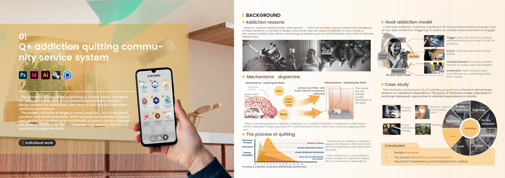
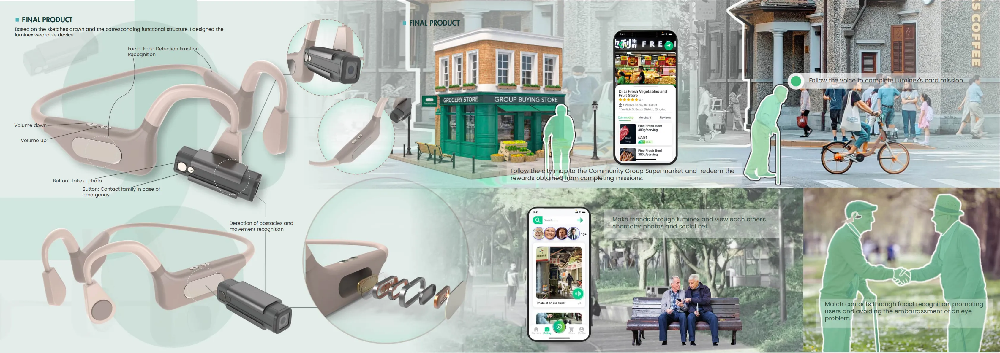
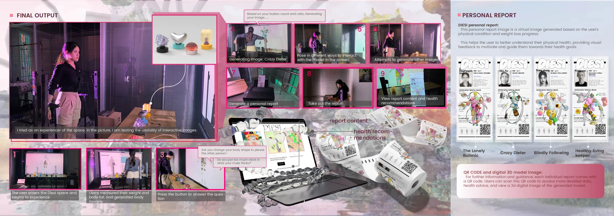

This page presents selected design-led research projects spanning embodied interaction, accessibility, service systems, and responsible technology. The complete visual portfolio is available at [yingfangzhong.com](https://www.yingfangzhong.com/).

Q+ Addiction Quitting Community Service System
======

Q+ is a community-based support system for people attempting to change addictive behaviours. The project combines interviews, expert consultation, AEIOU observation, personas, stakeholder mapping, and a service blueprint with a mobile service, responsive bracelet, smart planter, and neighbourhood support space.

I built and tested a functional bracelet prototype using a galvanic skin response sensor, Arduino, pneumatic actuation, and light feedback. Physiological changes are translated into a breathing-like physical signal, while the connected planter and app make progress visible over time.

Luminex: Wearable Mobility Aid for Older Adults with Low Vision
======

Luminex supports safer mobility and social participation for older adults with low vision. The research combined observation, interviews, a day-long vision-simulation exercise, personas, journey mapping, and analysis of the needs shared by older adults and family caregivers.

The concept pairs a bone-conduction wearable with a mobile service providing obstacle alerts, audio navigation, emergency contact, community activities, and a family-facing view.

SeaSpark: Marine Sustainability and Fishermen Support
======

SeaSpark addresses marine waste and the economic pressure faced by fishing communities during seasonal fishing bans. The project is grounded in on-boat observation, stakeholder interviews, and 197 valid questionnaires collected from fishing villages in Qingdao.

The service connects sustainable-fishing training, discarded-net recycling, traceable seafood, alternative employment, a public museum, and a market. A solar-powered recycling unit identifies waste categories and links returned materials to a reward and traceability system.

DIESI: Reframing Body Image and Diet Culture
======

DIESI is an interactive experience examining how social media, relationship pressure, and diet culture shape body image. The research used desk research, cultural probes, a questionnaire, and an empathy map.

The installation combines body measurement, Kinect motion capture, TouchDesigner, Blender models, projected visuals, tactile buttons, and a printed personal report. Participants encounter a responsive digital body and receive reflective feedback designed to support healthier self-perception.

