<link rel="stylesheet" href="{{ '/assets/css/visual-research.css' | relative_url }}">

Selected projects in interaction design, tangible interfaces, accessibility and service innovation. This page restores the <strong>complete 27-page visual portfolio</strong>, arranged by project rather than only showing two overview images for each work.

<nav class="portfolio-jump" aria-label="Portfolio project navigation"><a href="#qplus">Q+</a> · <a href="#luminex">Luminex</a> · <a href="#seaspark">SeaSpark</a> · <a href="#diesi">DIESI</a></nav>

<figure class="portfolio-page portfolio-cover"></figure>

<section class="visual-section" id="qplus">
<h2>Q+ — Addiction Quitting Community Service System</h2>

A community-based service system supporting people changing addictive behaviours. It combines field research, service design, a mobile experience, a GSR-enabled responsive bracelet, pneumatic feedback, a smart planter, and a neighbourhood support space.

<figure class="portfolio-page"><figcaption>Original portfolio · Page 2 of 27 · <a href="/images/portfolio-full/Yingfangzhong_SUN_Portfolio_01.webp" target="_blank" rel="noopener">View full size</a></figcaption></figure>
<figure class="portfolio-page"><a href="/images/portfolio-full/Yingfangzhong_SUN_Portfolio_02.webp" target="_blank" rel="noopener" aria-label="Open full image for Q+ — Addiction Quitting Community Service System, page 3">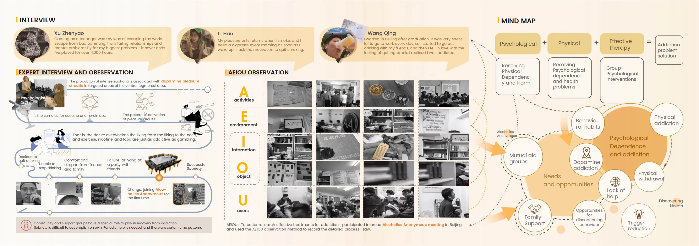</a><figcaption>Original portfolio · Page 3 of 27 · <a href="/images/portfolio-full/Yingfangzhong_SUN_Portfolio_02.webp" target="_blank" rel="noopener">View full size</a></figcaption></figure>
<figure class="portfolio-page"><a href="/images/portfolio-full/Yingfangzhong_SUN_Portfolio_03.webp" target="_blank" rel="noopener" aria-label="Open full image for Q+ — Addiction Quitting Community Service System, page 4">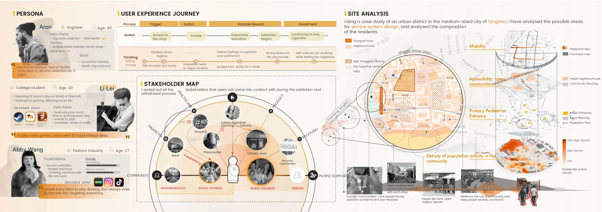</a><figcaption>Original portfolio · Page 4 of 27 · <a href="/images/portfolio-full/Yingfangzhong_SUN_Portfolio_03.webp" target="_blank" rel="noopener">View full size</a></figcaption></figure>
<figure class="portfolio-page"><a href="/images/portfolio-full/Yingfangzhong_SUN_Portfolio_04.webp" target="_blank" rel="noopener" aria-label="Open full image for Q+ — Addiction Quitting Community Service System, page 5">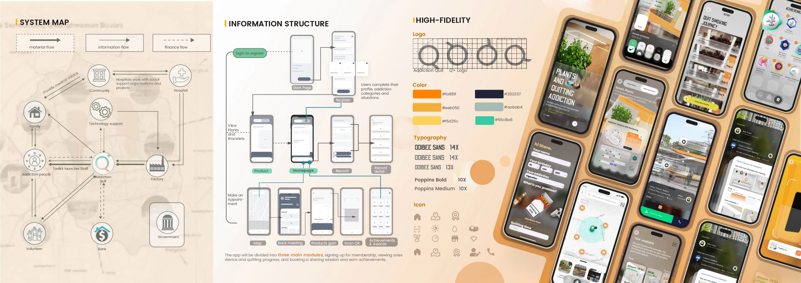</a><figcaption>Original portfolio · Page 5 of 27 · <a href="/images/portfolio-full/Yingfangzhong_SUN_Portfolio_04.webp" target="_blank" rel="noopener">View full size</a></figcaption></figure>
<figure class="portfolio-page"><a href="/images/portfolio-full/Yingfangzhong_SUN_Portfolio_05.webp" target="_blank" rel="noopener" aria-label="Open full image for Q+ — Addiction Quitting Community Service System, page 6">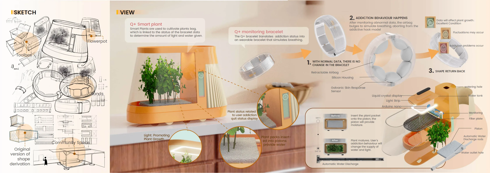</a><figcaption>Original portfolio · Page 6 of 27 · <a href="/images/portfolio-full/Yingfangzhong_SUN_Portfolio_05.webp" target="_blank" rel="noopener">View full size</a></figcaption></figure>
<figure class="portfolio-page"><a href="/images/portfolio-full/Yingfangzhong_SUN_Portfolio_06.webp" target="_blank" rel="noopener" aria-label="Open full image for Q+ — Addiction Quitting Community Service System, page 7">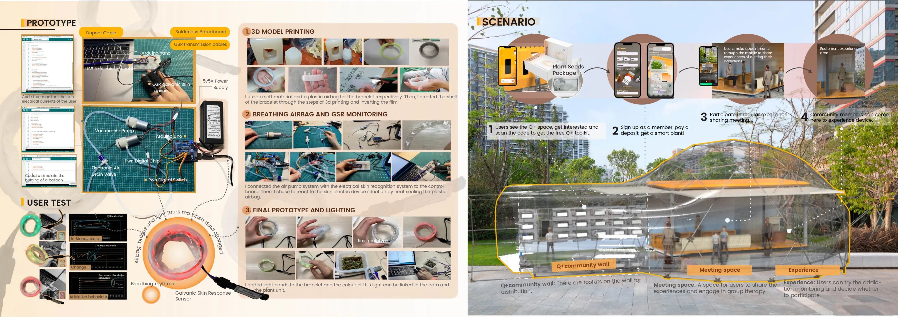</a><figcaption>Original portfolio · Page 7 of 27 · <a href="/images/portfolio-full/Yingfangzhong_SUN_Portfolio_06.webp" target="_blank" rel="noopener">View full size</a></figcaption></figure>
<figure class="portfolio-page"><a href="/images/portfolio-full/Yingfangzhong_SUN_Portfolio_07.webp" target="_blank" rel="noopener" aria-label="Open full image for Q+ — Addiction Quitting Community Service System, page 8">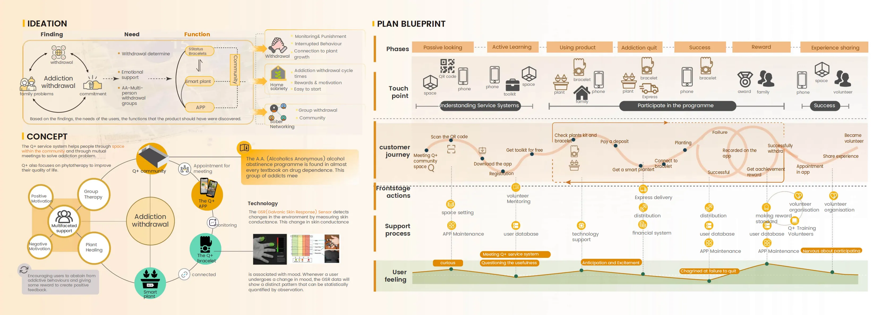</a><figcaption>Original portfolio · Page 8 of 27 · <a href="/images/portfolio-full/Yingfangzhong_SUN_Portfolio_07.webp" target="_blank" rel="noopener">View full size</a></figcaption></figure>

</section>

<section class="visual-section" id="luminex">
<h2>Luminex — Mobility Support for Older Adults with Low Vision</h2>

An inclusive mobility concept combining a bone-conduction wearable, audio navigation, obstacle awareness, emergency support, and community participation. The design is informed by interviews, observation, visual-simulation exercises, and journey mapping.

<figure class="portfolio-page"><a href="/images/portfolio-full/Yingfangzhong_SUN_Portfolio_08.webp" target="_blank" rel="noopener" aria-label="Open full image for Luminex — Mobility Support for Older Adults with Low Vision, page 9">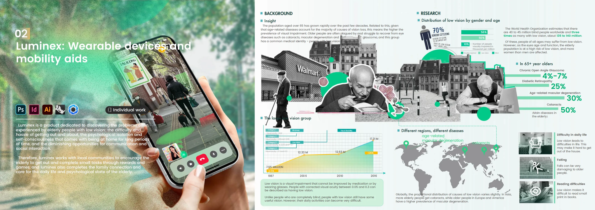</a><figcaption>Original portfolio · Page 9 of 27 · <a href="/images/portfolio-full/Yingfangzhong_SUN_Portfolio_08.webp" target="_blank" rel="noopener">View full size</a></figcaption></figure>
<figure class="portfolio-page"><a href="/images/portfolio-full/Yingfangzhong_SUN_Portfolio_09.webp" target="_blank" rel="noopener" aria-label="Open full image for Luminex — Mobility Support for Older Adults with Low Vision, page 10">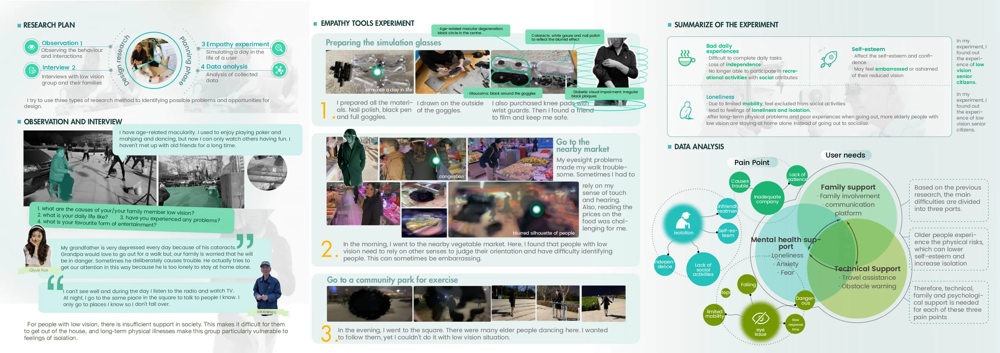</a><figcaption>Original portfolio · Page 10 of 27 · <a href="/images/portfolio-full/Yingfangzhong_SUN_Portfolio_09.webp" target="_blank" rel="noopener">View full size</a></figcaption></figure>
<figure class="portfolio-page"><a href="/images/portfolio-full/Yingfangzhong_SUN_Portfolio_10.webp" target="_blank" rel="noopener" aria-label="Open full image for Luminex — Mobility Support for Older Adults with Low Vision, page 11">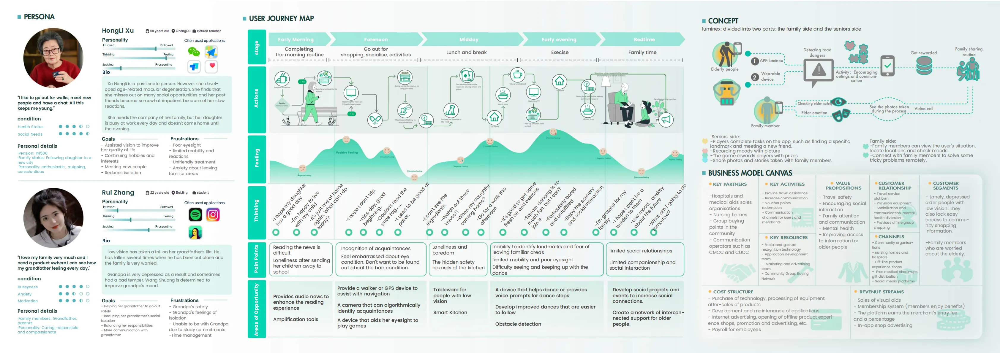</a><figcaption>Original portfolio · Page 11 of 27 · <a href="/images/portfolio-full/Yingfangzhong_SUN_Portfolio_10.webp" target="_blank" rel="noopener">View full size</a></figcaption></figure>
<figure class="portfolio-page"><a href="/images/portfolio-full/Yingfangzhong_SUN_Portfolio_11.webp" target="_blank" rel="noopener" aria-label="Open full image for Luminex — Mobility Support for Older Adults with Low Vision, page 12">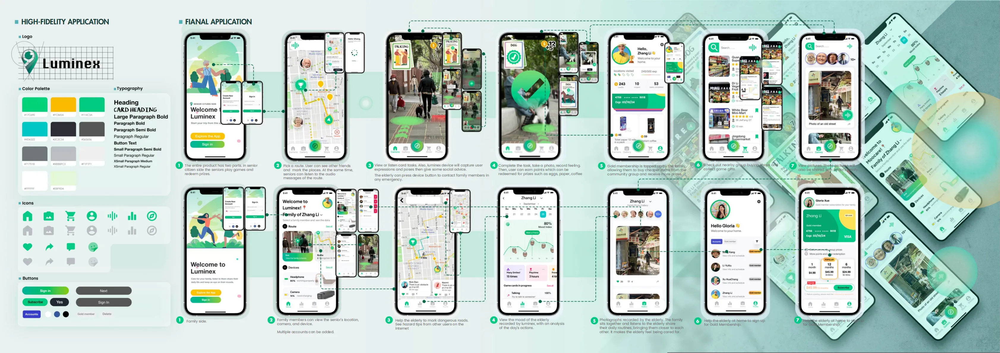</a><figcaption>Original portfolio · Page 12 of 27 · <a href="/images/portfolio-full/Yingfangzhong_SUN_Portfolio_11.webp" target="_blank" rel="noopener">View full size</a></figcaption></figure>
<figure class="portfolio-page"><figcaption>Original portfolio · Page 13 of 27 · <a href="/images/portfolio-full/Yingfangzhong_SUN_Portfolio_12.webp" target="_blank" rel="noopener">View full size</a></figcaption></figure>
<figure class="portfolio-page"><a href="/images/portfolio-full/Yingfangzhong_SUN_Portfolio_13.webp" target="_blank" rel="noopener" aria-label="Open full image for Luminex — Mobility Support for Older Adults with Low Vision, page 14">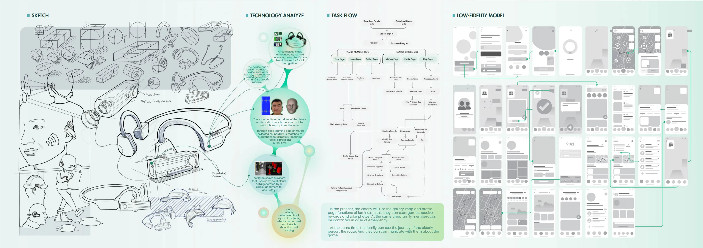</a><figcaption>Original portfolio · Page 14 of 27 · <a href="/images/portfolio-full/Yingfangzhong_SUN_Portfolio_13.webp" target="_blank" rel="noopener">View full size</a></figcaption></figure>

</section>

<section class="visual-section" id="seaspark">
<h2>SeaSpark — Marine Sustainability & Fishing Communities</h2>

A service ecosystem addressing abandoned fishing nets and livelihood challenges during fishing bans. The project explores net recycling, traceable seafood, community education, sustainable employment, and a solar-powered recycling unit.

<figure class="portfolio-page"><a href="/images/portfolio-full/Yingfangzhong_SUN_Portfolio_14.webp" target="_blank" rel="noopener" aria-label="Open full image for SeaSpark — Marine Sustainability & Fishing Communities, page 15">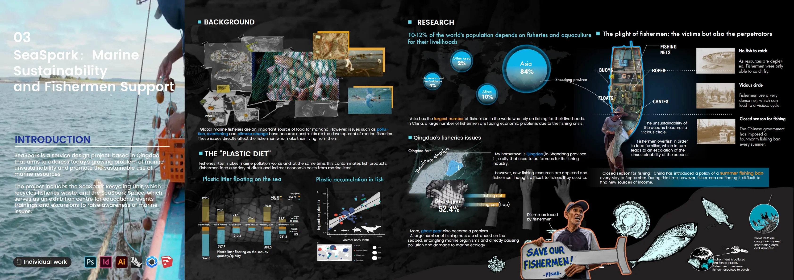</a><figcaption>Original portfolio · Page 15 of 27 · <a href="/images/portfolio-full/Yingfangzhong_SUN_Portfolio_14.webp" target="_blank" rel="noopener">View full size</a></figcaption></figure>
<figure class="portfolio-page"><a href="/images/portfolio-full/Yingfangzhong_SUN_Portfolio_15.webp" target="_blank" rel="noopener" aria-label="Open full image for SeaSpark — Marine Sustainability & Fishing Communities, page 16">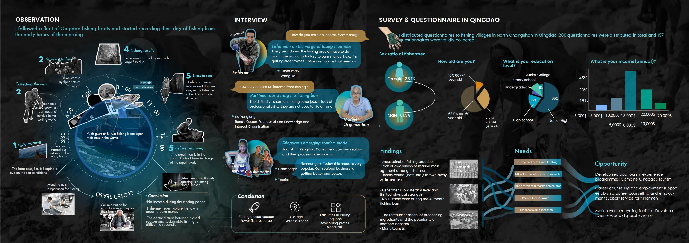</a><figcaption>Original portfolio · Page 16 of 27 · <a href="/images/portfolio-full/Yingfangzhong_SUN_Portfolio_15.webp" target="_blank" rel="noopener">View full size</a></figcaption></figure>
<figure class="portfolio-page"><a href="/images/portfolio-full/Yingfangzhong_SUN_Portfolio_16.webp" target="_blank" rel="noopener" aria-label="Open full image for SeaSpark — Marine Sustainability & Fishing Communities, page 17">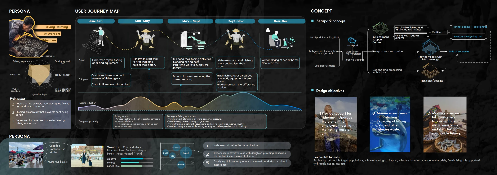</a><figcaption>Original portfolio · Page 17 of 27 · <a href="/images/portfolio-full/Yingfangzhong_SUN_Portfolio_16.webp" target="_blank" rel="noopener">View full size</a></figcaption></figure>
<figure class="portfolio-page"><a href="/images/portfolio-full/Yingfangzhong_SUN_Portfolio_17.webp" target="_blank" rel="noopener" aria-label="Open full image for SeaSpark — Marine Sustainability & Fishing Communities, page 18">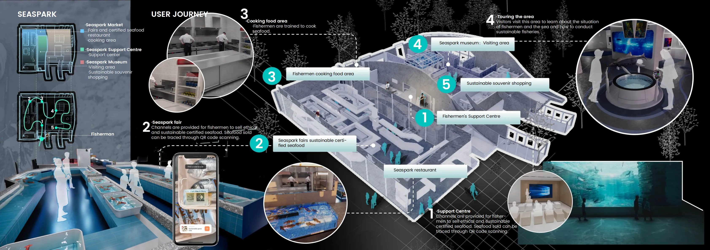</a><figcaption>Original portfolio · Page 18 of 27 · <a href="/images/portfolio-full/Yingfangzhong_SUN_Portfolio_17.webp" target="_blank" rel="noopener">View full size</a></figcaption></figure>
<figure class="portfolio-page"><a href="/images/portfolio-full/Yingfangzhong_SUN_Portfolio_18.webp" target="_blank" rel="noopener" aria-label="Open full image for SeaSpark — Marine Sustainability & Fishing Communities, page 19">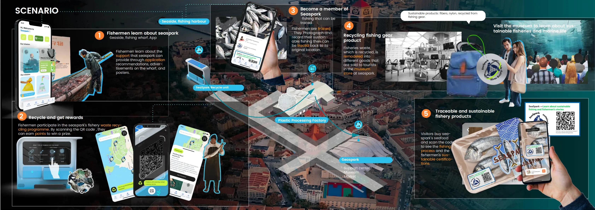</a><figcaption>Original portfolio · Page 19 of 27 · <a href="/images/portfolio-full/Yingfangzhong_SUN_Portfolio_18.webp" target="_blank" rel="noopener">View full size</a></figcaption></figure>
<figure class="portfolio-page"><a href="/images/portfolio-full/Yingfangzhong_SUN_Portfolio_19.webp" target="_blank" rel="noopener" aria-label="Open full image for SeaSpark — Marine Sustainability & Fishing Communities, page 20">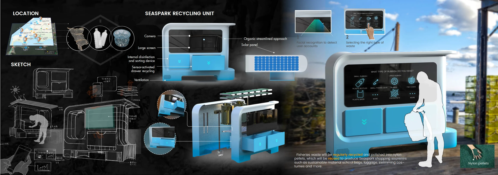</a><figcaption>Original portfolio · Page 20 of 27 · <a href="/images/portfolio-full/Yingfangzhong_SUN_Portfolio_19.webp" target="_blank" rel="noopener">View full size</a></figcaption></figure>
<figure class="portfolio-page"><a href="/images/portfolio-full/Yingfangzhong_SUN_Portfolio_20.webp" target="_blank" rel="noopener" aria-label="Open full image for SeaSpark — Marine Sustainability & Fishing Communities, page 21">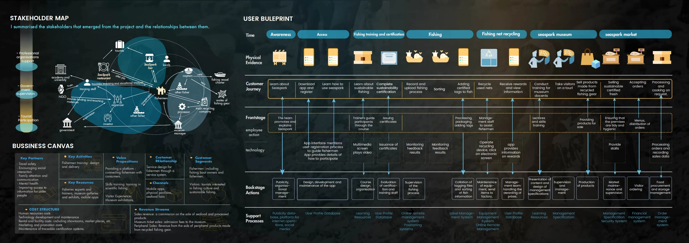</a><figcaption>Original portfolio · Page 21 of 27 · <a href="/images/portfolio-full/Yingfangzhong_SUN_Portfolio_20.webp" target="_blank" rel="noopener">View full size</a></figcaption></figure>

</section>

<section class="visual-section" id="diesi">
<h2>DIESI — Body Image & Diet Culture</h2>

An interactive installation examining body image in the context of social media and diet culture. It uses body measurements, Kinect-based movement input, TouchDesigner visuals, digital 3D models, and a personalised reflection output.

<figure class="portfolio-page"><a href="/images/portfolio-full/Yingfangzhong_SUN_Portfolio_21.webp" target="_blank" rel="noopener" aria-label="Open full image for DIESI — Body Image & Diet Culture, page 22">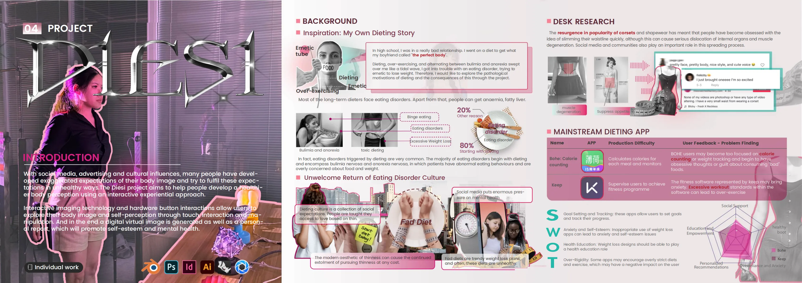</a><figcaption>Original portfolio · Page 22 of 27 · <a href="/images/portfolio-full/Yingfangzhong_SUN_Portfolio_21.webp" target="_blank" rel="noopener">View full size</a></figcaption></figure>
<figure class="portfolio-page"><a href="/images/portfolio-full/Yingfangzhong_SUN_Portfolio_22.webp" target="_blank" rel="noopener" aria-label="Open full image for DIESI — Body Image & Diet Culture, page 23">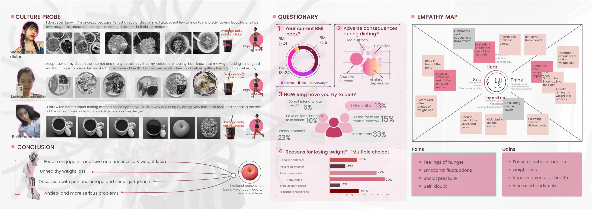</a><figcaption>Original portfolio · Page 23 of 27 · <a href="/images/portfolio-full/Yingfangzhong_SUN_Portfolio_22.webp" target="_blank" rel="noopener">View full size</a></figcaption></figure>
<figure class="portfolio-page"><a href="/images/portfolio-full/Yingfangzhong_SUN_Portfolio_23.webp" target="_blank" rel="noopener" aria-label="Open full image for DIESI — Body Image & Diet Culture, page 24">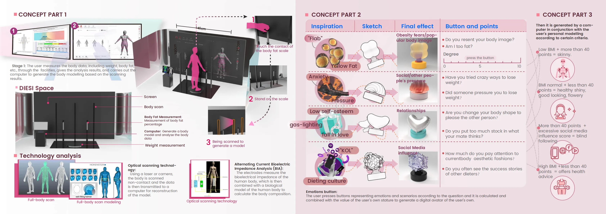</a><figcaption>Original portfolio · Page 24 of 27 · <a href="/images/portfolio-full/Yingfangzhong_SUN_Portfolio_23.webp" target="_blank" rel="noopener">View full size</a></figcaption></figure>
<figure class="portfolio-page"><a href="/images/portfolio-full/Yingfangzhong_SUN_Portfolio_24.webp" target="_blank" rel="noopener" aria-label="Open full image for DIESI — Body Image & Diet Culture, page 25">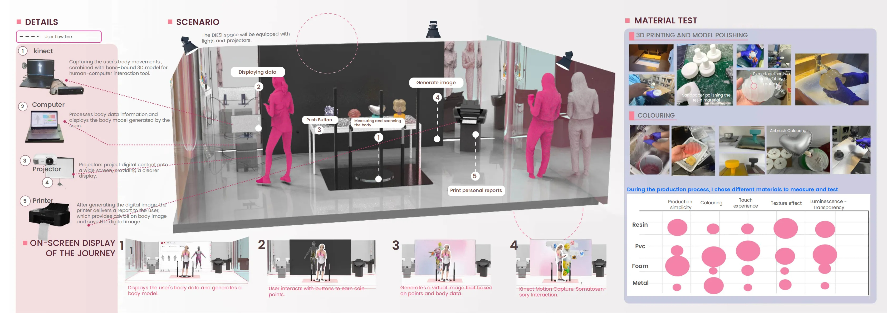</a><figcaption>Original portfolio · Page 25 of 27 · <a href="/images/portfolio-full/Yingfangzhong_SUN_Portfolio_24.webp" target="_blank" rel="noopener">View full size</a></figcaption></figure>
<figure class="portfolio-page"><figcaption>Original portfolio · Page 26 of 27 · <a href="/images/portfolio-full/Yingfangzhong_SUN_Portfolio_25.webp" target="_blank" rel="noopener">View full size</a></figcaption></figure>
<figure class="portfolio-page"><a href="/images/portfolio-full/Yingfangzhong_SUN_Portfolio_26.webp" target="_blank" rel="noopener" aria-label="Open full image for DIESI — Body Image & Diet Culture, page 27">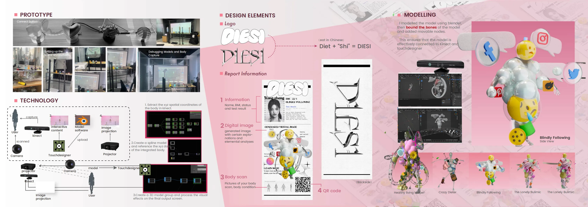</a><figcaption>Original portfolio · Page 27 of 27 · <a href="/images/portfolio-full/Yingfangzhong_SUN_Portfolio_26.webp" target="_blank" rel="noopener">View full size</a></figcaption></figure>

</section>

All visuals above come from my original 2025 portfolio. For newer research projects and their figures, please visit <a href="/research/">Research</a>.

